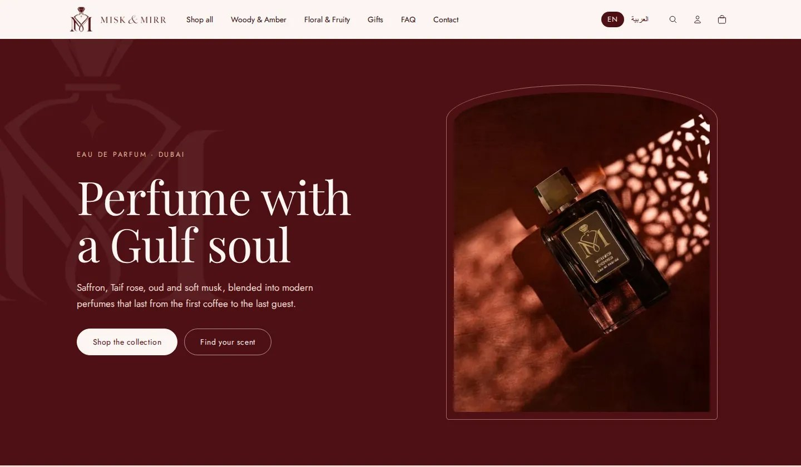
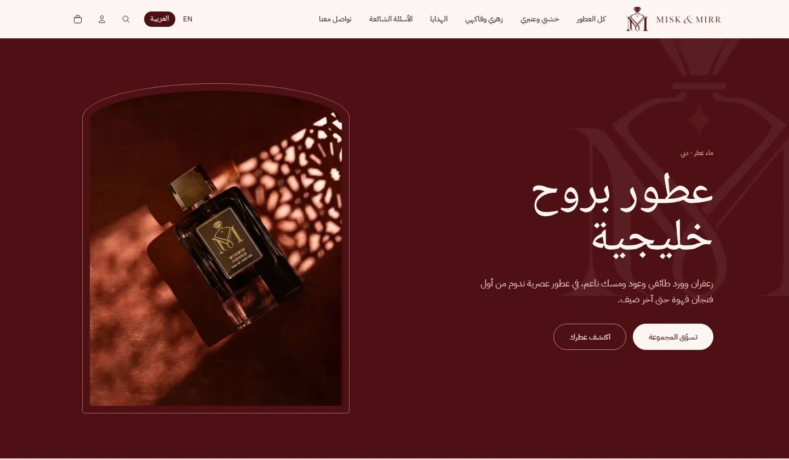

# Misk & Mirr · Shopify theme work

**Custom theme blocks for a bilingual Shopify perfume store** · designed and built by **Arooj Fatima**

Custom Online Store 2.0 theme work for Misk & Mirr, a perfume brand for the UAE: an arched hero, scent-note band, mood tiles, a product-matching scent quiz and a notes card fed by product metafields, plus English and Arabic locale strings. This repository holds the custom files only; they sit on top of the store’s base theme.

## Tech
- Shopify Online Store 2.0
- Liquid
- JavaScript (web components)
- Admin GraphQL API
- Arabic RTL

## Notes
Self-initiated concept project with sample data, built to the standard of client work. No real bookings, orders or payments are made.

The full case study, with the design decisions behind it, is on my portfolio.
